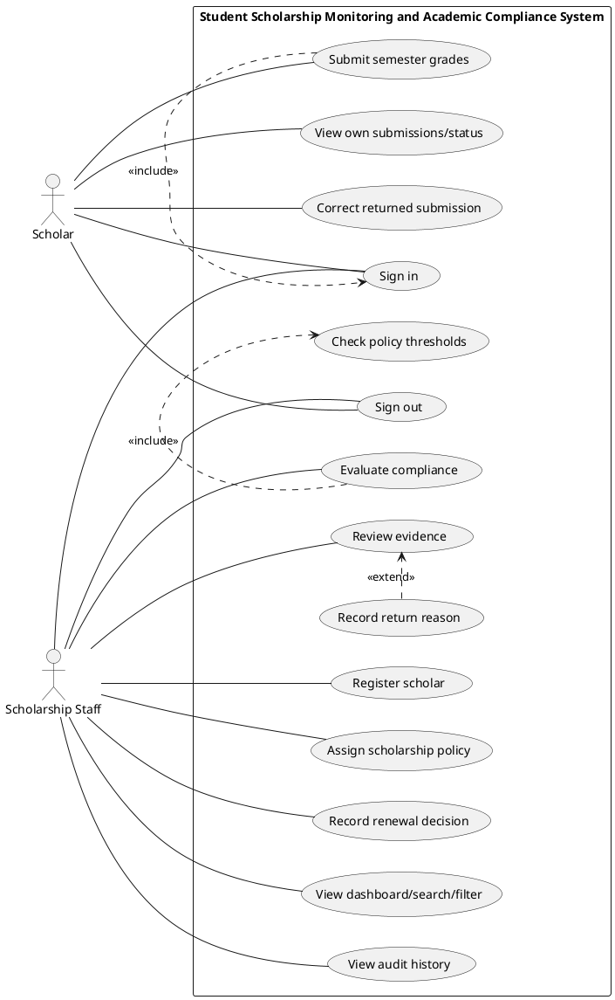
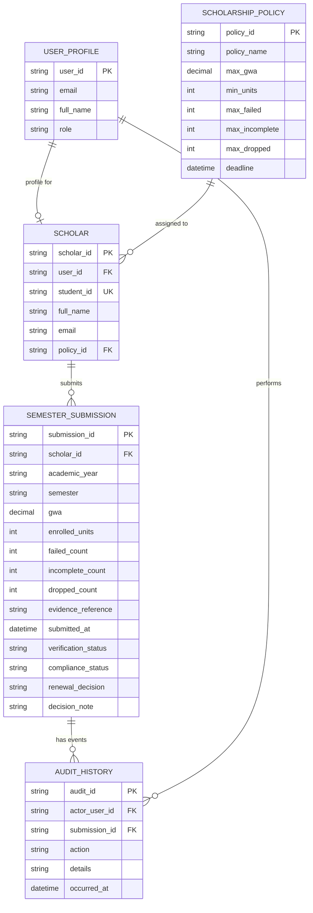

# Part I — Analysis and Design
## Student Scholarship Monitoring and Academic Compliance System

**Course:** ITPC111 — Systems Analysis and Design  
**Institution:** Agusan del Sur State University  
**Section:** A  
**Student:** ____________________  
**Student ID:** ____________________  
**Instructor:** ____________________  
**Status:** Requirements baseline and implementation mapping

## A1. Investigation and planning

### Problem statement
The Scholarship Office uses spreadsheets, email attachments, and paper grade records to monitor Merit Scholar and Community Scholar grants. This causes duplicate semester records, unverified grade evidence, missed deadlines, inconsistent scholarship decisions, and poor visibility for scholars. The proposed browser-based system centralizes academic submissions, verification, policy evaluation, renewal decisions, and history. The Registrar remains the source of official grades; the system does not change official grades or release scholarship payments.

### Problem, cause, and effect
| ID | Problem | Likely cause | Effect |
|---|---|---|---|
| P01 | Duplicate semester submissions | Separate spreadsheets and no unique term rule | Conflicting or repeated records |
| P02 | Grade evidence not verified consistently | Email and paper-based checking | Incorrect or delayed evaluation |
| P03 | Missed deadlines | Manual reminders and tracking | Late submissions and renewal delays |
| P04 | Inconsistent renewal decisions | Policy thresholds not centralized | Unequal decisions and weak auditability |

### Scope
The system authenticates Scholar and Scholarship Staff users; stores scholar profiles and policy assignments; accepts semester summaries and evidence references; prevents duplicate scholar/year/semester submissions; verifies or returns evidence with reasons; permits correction and resubmission; evaluates verified summaries using saved program thresholds; records Approved or Held renewal decisions; displays dashboard counts, search, filters, and audit history.

### Exclusions
Official grade creation or modification; direct Registrar integration; scholarship payment; SMS gateway; machine-learning prediction; a complete appeal workflow; production-grade file storage; and exception handling outside the fictional exam policy.

### Four development tasks
1. Create the data model, seed records, authentication, and role-protected API.
2. Implement scholar assignment and validated semester submissions.
3. Implement verification, returned-record correction, compliance evaluation, and renewal decisions.
4. Implement dashboard/search/audit history, run TC01–TC10, document defects, and package the source.

### Risks and responses
| Risk | Response |
|---|---|
| Unauthorized access to another scholar’s record | Enforce ownership and role checks in API handlers; do not rely on hidden buttons |
| Policy thresholds become inconsistent across programs | Store thresholds in policy records and read them during each evaluation |

## A2. Stakeholders and elicitation

### Stakeholders vs. actual system actors
| Stakeholder | Interest | Actual actor in this MVP? |
|---|---|---|
| Scholarship Staff | Register scholars, verify evidence, evaluate, decide renewal, report | Yes — Scholarship Staff |
| Scholar | Submit academic summaries and track status | Yes — Scholar |
| Registrar | Source of official grades and evidence | No direct login/integration in scope |
| Scholarship Office management | Monitor workload and review decisions/reports | Stakeholder; no separate role in the required two-role MVP |

### Open-ended elicitation questions
1. How does staff confirm that a submitted grade-document reference is authentic and complete?
2. What deadlines apply to each scholarship program, and how should late submissions be recorded?
3. How are policy thresholds approved, updated, and communicated to staff and scholars?
4. What situations require a submission to be returned, and what explanation must the scholar receive?
5. How should staff handle a policy exception, given that exceptions are outside this exam’s scope?
6. What dashboard summaries and reports does the Scholarship Office need for a selected semester?

## A3. Requirements and business rules

### Functional requirements
| ID | Requirement / acceptance condition |
|---|---|
| FR01 | The system shall authenticate users and assign either Scholar or Scholarship Staff role. |
| FR02 | The system shall restrict scholars to their own submissions at the API/backend level. |
| FR03 | Staff shall register a scholar and assign one persisted scholarship policy. |
| FR04 | A scholar shall submit academic year, semester, GWA, units, failed count, incomplete count, dropped count, and evidence reference. |
| FR05 | The system shall reject GWA outside 1.00–5.00 and negative or non-integer unit/count values. |
| FR06 | The system shall reject a duplicate scholar + academic year + semester submission. |
| FR07 | Staff shall verify evidence or return it with a reason; corrected returned submissions shall return to Pending verification. |
| FR08 | The system shall evaluate only Verified submissions and show each policy deficiency reason. |
| FR09 | Staff shall record Approved or Held renewal decisions; approval shall require a Compliant evaluation. |
| FR10 | The system shall display dashboard counts, search/filter submissions, persist data after refresh, and log key actions with actor and timestamp. |

### Non-functional requirements
| ID | Measurable requirement |
|---|---|
| NFR01 | At 100 synthetic submissions on a local machine, list and dashboard requests should return within 2 seconds under normal conditions. |
| NFR02 | All role and ownership checks must be enforced by the server; direct API attempts by unauthorized users must receive HTTP 401 or 403. |
| NFR03 | After a successful write, data and audit entries must remain after page refresh and server restart. |
| NFR04 | Main pages must support desktop and mobile layouts down to 360px width without horizontal page overflow; data tables may scroll horizontally. |

### Business rules
| ID | Rule |
|---|---|
| BR01 | Merit Scholar maximum GWA 1.75; minimum 18 units; allowed failed 0; incomplete 0; dropped 0. |
| BR02 | Community Scholar maximum GWA 2.25; minimum 15 units; allowed failed 0; incomplete 0; dropped 1. |
| BR03 | The deadline for both policies is October 30, 2026, at 17:00 Asia/Manila. A submission exactly at the deadline is on time; after it is late. |
| BR04 | A submission requires an evidence reference and must be Verified before final compliance evaluation. |
| BR05 | GWA is valid from 1.00 to 5.00 inclusive; units and counts must be nonnegative integers. |
| BR06 | Only staff may verify, evaluate, and decide renewal. Staff cannot approve a record with With Deficiency; scholars cannot change renewal decisions. |

**Status distinction:** Verification status, academic compliance status, and renewal decision are separate fields. A submission can be Verified, With Deficiency, and Held at the same time. An evaluation flag alone does not automatically disqualify a scholar; the staff member explicitly records a permitted renewal decision.

## A4. UML use-case model

### Relationship justification
- **Submit semester grades `include` Sign in:** submission requires an authenticated scholar session. This is a mandatory prerequisite in the model.
- **Evaluate compliance `include` Check policy thresholds:** each evaluation must read and check the assigned policy thresholds; this is required behavior, not an optional branch.
- **Record return reason `extend` Review evidence:** a reason is captured conditionally when staff choose Returned rather than Verified. The extension is conditional at the evidence-review step.

The implementation also treats authentication as a precondition in route guards, consistent with the exam reminder that authentication need not be repeated as an include for every use case.

## A5. Detailed use cases

### UC03 — Submit Grades
- **Primary actor:** Scholar
- **Trigger:** Scholar selects the semester submission form and submits it.
- **Preconditions:** Scholar is authenticated; account is assigned to a scholar profile.
- **Main flow:**
  1. Scholar enters academic year and semester.
  2. Scholar enters GWA, enrolled units, failed count, incomplete count, and dropped count.
  3. Scholar enters a grade-document reference.
  4. System validates required fields, GWA range, and nonnegative integer counts/units.
  5. System checks that the scholar/year/semester combination does not already exist.
  6. System records submission timestamp and saves the record as Pending verification and Not Evaluated.
  7. System displays confirmation and the new status.
- **Alternative flows:** Invalid fields return a clear validation message; an existing scholar/year/semester combination is rejected with a duplicate message.
- **Exception flows:** Unauthenticated requests receive 401; staff attempting to submit as a scholar receive 403; storage/server errors return an error response.
- **Postcondition:** One persisted submission exists with a timestamp, evidence reference, Pending verification status, and audit event.
- **Linked requirements/rules:** FR01, FR02, FR04, FR05, FR06, FR10; BR04, BR05.

### UC09 — Evaluate Compliance
- **Primary actor:** Scholarship Staff
- **Trigger:** Staff selects Evaluate for a submission.
- **Preconditions:** Staff is authenticated; evidence status is Verified; scholar has a saved policy assignment.
- **Main flow:**
  1. Staff opens the submission and reviews its academic summary.
  2. System confirms the evidence is Verified.
  3. System loads thresholds from the scholar’s assigned policy record.
  4. System checks GWA, units, failed subjects, incomplete grades, dropped subjects, evidence reference, and deadline.
  5. System stores Compliant if all checks pass; otherwise it stores With Deficiency and each failed condition.
  6. System resets renewal decision to Pending until staff explicitly decide.
  7. System writes actor, timestamp, evaluation result, and reasons to audit history.
- **Alternative flows:** If any academic condition or deadline fails, the system stores With Deficiency with specific reasons.
- **Exception flows:** Pending or Returned evidence blocks evaluation; missing policy assignment blocks evaluation.
- **Postcondition:** A verified submission has a saved compliance result and reasons; no renewal is automatically approved.
- **Linked requirements/rules:** FR03, FR08, FR09, FR10; BR01–BR06.

### Core ERD (relational proposal)

**Cardinalities:** One policy can be assigned to many scholars (1:M). One scholar can make many semester submissions (1:M). One submission can have many audit-history events (1:M). One user profile may link to zero or one scholar profile; staff accounts do not need a scholar profile (1:0..1). A separate decision-history table can be added if the deployment requires a normalized immutable record for every decision; in this MVP, each state change is captured in audit history.

## A6. Traceability matrix

| FR | Actor | Use case | BR | Implemented screen/function | Test and expected result |
|---|---|---|---|---|---|
| FR02 | Scholar | View own submissions | BR06 | Supabase `semester_submission` SELECT policy | TC08: another scholar’s submission returns 403 |
| FR04/FR05 | Scholar | Submit grades | BR04/BR05 | Supabase insert policy, table constraints, and unique constraint | TC07: invalid GWA/count rejected |
| FR07 | Staff / Scholar | Review evidence / correct returned | BR04 | `staff_verify_submission` and `resubmit_correction` SQL RPC functions | TC09: corrected record becomes Pending |
| FR08/FR09 | Staff | Evaluate / record decision | BR01–BR06 | `evaluate_compliance` and `staff_record_renewal_decision` SQL RPC functions | TC01–TC06, TC10: correct reasons and approval restrictions |

### Planned or limited items
- Supabase schema and RLS policies are provided in `docs/schema.sql`; they must be run in the user’s own Supabase project and tested there. This package has not been connected to a live Supabase project because project credentials were not provided.
- File upload and live Registrar validation are excluded by the exam; only a document reference is stored.
- Authentication is delegated to Supabase Auth. Only the public anon/publishable key belongs in `public/config.js`; never expose a service-role key.
